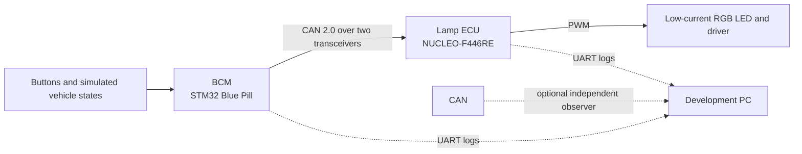

# Automotive Ambient Lighting ECU

An educational, low-voltage, two-node body-electronics prototype: a Body Control Module (BCM) on an STM32 Blue Pill sends lighting commands over CAN to a Lamp ECU on an STM32 NUCLEO-F446RE. The Lamp ECU is planned to drive a small RGB LED through PWM.

> **Project boundary:** This is a bench-top educational prototype. It is AUTOSAR-inspired, not an AUTOSAR implementation, and it makes no AUTOSAR or ISO 26262 compliance claim. Never connect it directly to a vehicle electrical system.

## Project status

| Phase | Deliverable | Status |
|---|---|---|
| 0 | Hardware/toolchain audit and board smoke tests | Procedures documented; hardware evidence not yet recorded |
| 1 | SRS, architecture, and requirement traceability | Drafted; decisions remain provisional pending owner review |
| 2 | Repository structure, module contracts, host checks, and conventions | Interface-only baseline prepared; CubeIDE integration and target builds remain unverified |
| 3–10 | Lamp firmware, BCM firmware, CAN integration, system validation, AUTOSAR learning, portfolio review | Not started |

There is no implemented firmware behavior or hardware validation evidence in this repository yet. Do not describe planned behavior as tested. Hardware-dependent assumptions are marked `[B]` in the engineering documents.

## System outline



The software is divided into hardware-independent application and communication contracts plus MCU-specific driver integration. The baseline uses a cooperative superloop; no RTOS or production AUTOSAR stack is included.

## Repository map

- `docs/handbook/engineering-handbook.md` — Phase 0 audit procedure, initial BOM, wiring considerations, risks, and roadmap.
- `docs/requirements/SRS.md` — system and software requirements with proposed project-defined targets.
- `docs/architecture/` — architecture, module interfaces, conventions, and Phase 2 CubeIDE integration guide.
- `docs/test-plans/RTM.csv` — planned requirement-to-test traceability; planned cases are not test results.
- `docs/validation-reports/` — reserved for dated, reproducible hardware and build evidence.
- `firmware/common/` — shared, HAL-free C interface headers and protocol contracts.
- `firmware/lamp_ecu/` and `firmware/bcm/` — ECU-specific interface headers; STM32CubeIDE generated projects are not included yet.
- `tests/unit/` — host-side interface/contract checks and CMake configuration.
- `tools/` — traceability and layering checkers, and the host test runner.
- `hardware/` — reserved for reviewed BOM, schematics, and wiring drawings.

## Start here

1. Read the Phase 0 steps in [the engineering handbook](docs/handbook/engineering-handbook.md). Record the actual Blue Pill MCU, available transceivers, LED polarity, programmer, and installed toolchain versions before settling pin/peripheral configuration.
2. Review the proposed behavior and thresholds in [the SRS](docs/requirements/SRS.md). Values are project targets, not automotive standards.
3. Review [the architecture](docs/architecture/architecture.md), [module interface map](docs/architecture/module-interfaces.md), and [Phase 2 guide](docs/architecture/phase2-guide.md).
4. Complete the documented CubeIDE integration and target build checks before beginning Phase 3.

## Host-side checks

Prerequisites: Python 3, CMake 3.16 or newer, a C compiler, and network access on the first test build to fetch the pinned Unity dependency.

From the repository root:

```powershell
python tools/check_layering.py
python tools/rtm_check.py
python tools/run_unit_tests.py --fresh
```

Expected summaries are `LAYERING CHECK PASSED`, `RTM CHECK PASSED` and `RESULT: ALL TESTS PASSED`. In the current workspace, the layering checker (including its self-test) and RTM checker pass. The host test runner could not execute here because CMake and CTest are not installed/on PATH. Once those prerequisites are installed, run the command above. These checks do not prove MCU builds, CAN electrical behavior, or end-to-end lighting operation.

## Hardware and safety

Use compatible CAN transceivers, a correctly terminated two-end bus, shared signal reference as appropriate, and current-limiting/driver circuitry for the LED. Verify board schematics and actual MCU markings before wiring. The exact pins, clocks, transceiver modules, and electrical results must be recorded from the hardware you use; this repository does not claim those checks have happened.

## Publish to GitHub

Create an empty GitHub repository, then from this directory:

```powershell
git init -b main
git add .
git commit -m "chore: prepare ambient lighting ECU project through phase 2"
git remote add origin https://github.com/<user>/<repository>.git
git push -u origin main
```

Authenticate through your normal Git credential manager, GitHub CLI, or SSH setup. Do not put access tokens in source files or chat. Choose and add a license before making the repository public; none is included because the owner has not selected one.

## Next evidence to record

Use the checklists and report templates in `docs/`. Keep observed results, tool versions, commands, and dates distinct from design intent. Do not mark a phase complete until its acceptance criteria are backed by the requested build logs or measurements.

