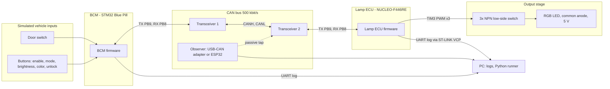
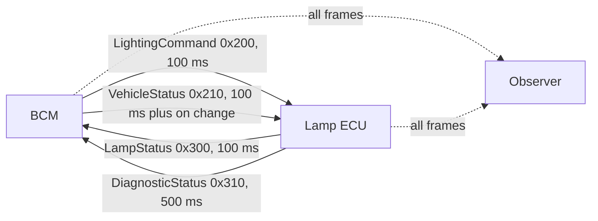
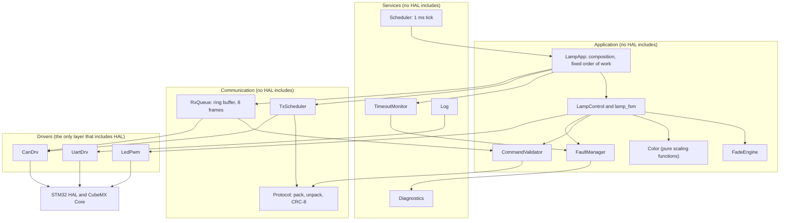
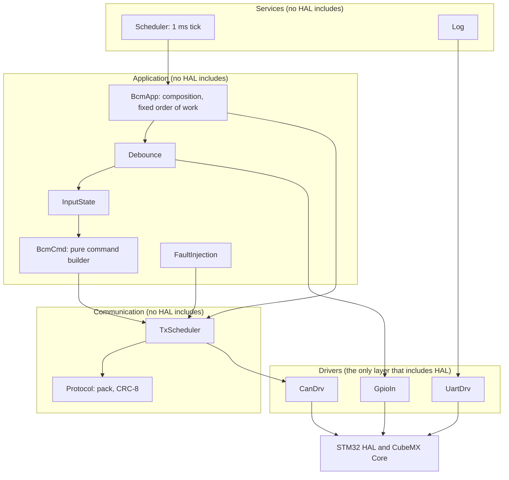
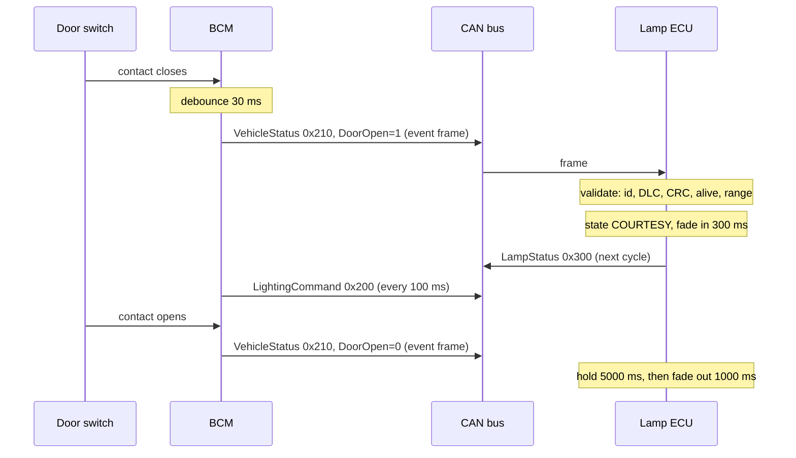
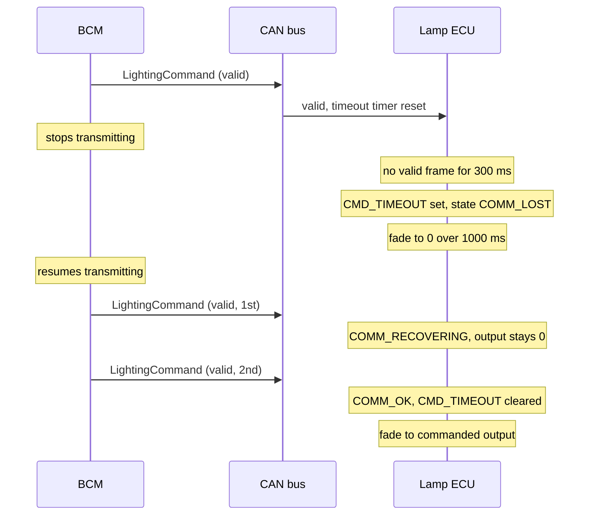
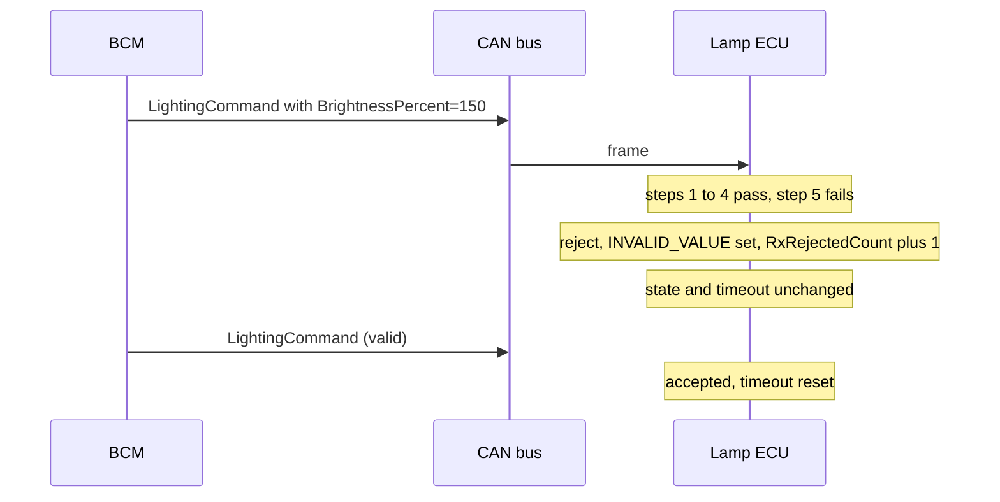
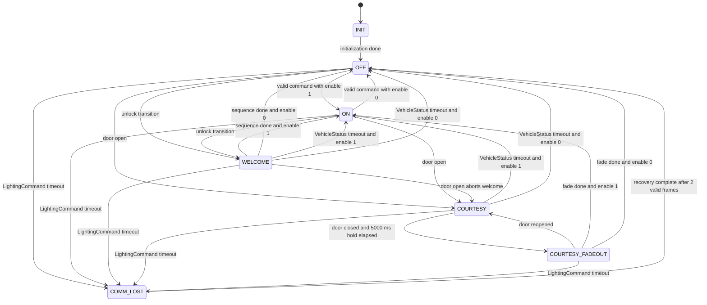
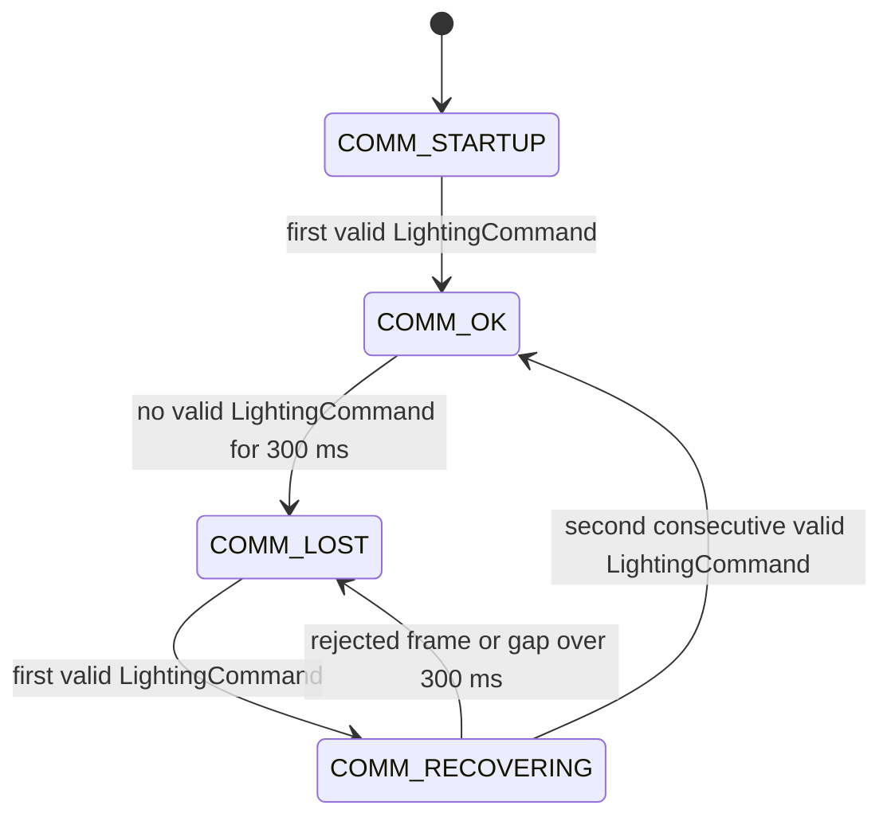
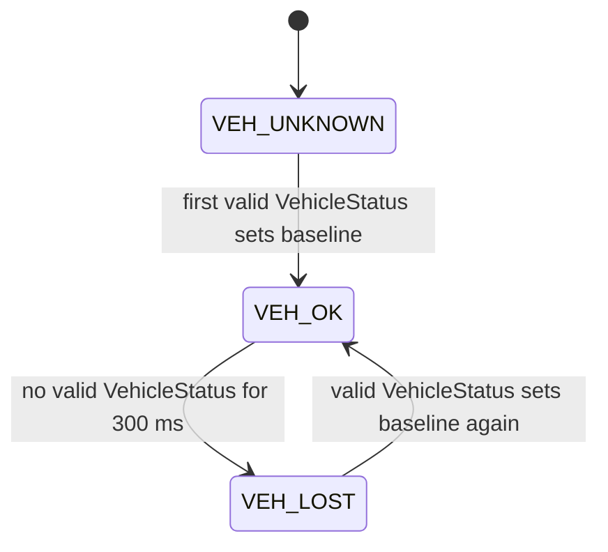

# Architecture

**Version:** 0.2 (Phase 2: layer rule corrected, composition modules and decisions added)
**Date:** 2026-10-21
**Related:** `docs/requirements/SRS.md`, `docs/architecture/module-interfaces.md`, `docs/architecture/coding-conventions.md`, `docs/handbook/engineering-handbook.md` v0.2

**Supersedes** the Phase 1 `architecture.md`. Changes are listed in section 9.

All diagrams are Mermaid text, so they are versioned with the code and render on GitHub. The architecture is **AUTOSAR-inspired**. It is not an AUTOSAR implementation.

---

## 1. System block diagram

The observer is passive. It must never transmit during normal tests.

---

## 2. ECU interaction diagram

Responsibilities across the interface:

| Information | Owner | Consumer | Notes |
|---|---|---|---|
| Door state, lock state | BCM | Lamp ECU | Vehicle facts. The BCM does not decide lamp behavior for door and unlock |
| Lamp enable, mode, color, brightness, fade time | BCM | Lamp ECU | User preference, set by the BCM inputs |
| Lamp state machine, fades, overlay precedence | Lamp ECU | none | Lamp behavior is entirely inside the Lamp ECU |
| Actual output, lamp state, faults | Lamp ECU | BCM, observer | The BCM only logs them in this baseline |

---

## 3. Software architecture

### 3.1 Lamp ECU layers

### 3.2 BCM layers

### 3.3 Layer rules

1. Calls go **downward only**: a module may use modules of its own layer or of any lower layer, and never a higher layer. Layer ranks: Drivers 1, Communication 2, Services 3, Application 4. (The Phase 1 wording said "directly below". That contradicted the diagrams, where the Application layer calls the drivers. This is the corrected rule.) The rule is enforced by `tools/check_layering.py`.
2. Application, Services, and Communication never include `stm32*.h` or any HAL header. Only Drivers do.
3. Modules that can run on a PC (and therefore have host unit tests): `Protocol`, `crc8`, `Color`, `FadeEngine`, `CommandValidator`, `lamp_fsm`, `TimeoutMonitor`, `FaultManager`, `Diagnostics`, `RxQueue`, `Debounce`, `InputState`, `BcmCmd`, `TxScheduler` (with a stub driver).
4. The CAN receive interrupt only copies the frame into `RxQueue`. It never validates or touches application state.
5. No blocking waits and no `HAL_Delay` outside driver initialization.
6. `firmware/common/` holds modules of several layers. The layer of each header is declared in `tools/check_layering.py`.
7. The composition modules `LampApp` and `BcmApp` sit at the top of the Application layer. They are the only modules that know all the others and they define the order of work in each 10 ms pass (AD-07).

### 3.4 Module responsibilities

| Module | Node | Does | Does not |
|---|---|---|---|
| LedPwm | Lamp | Writes compare values to the timer channels, enforces 0 before start | Know colors, modes, or fades |
| Color | Lamp | Computes duty counts from color and brightness (LMP-003) | Touch hardware |
| FadeEngine | Lamp | Linear fades, breathing waveform, retarget continuity | Decide when to fade |
| lamp_fsm (in LampControl) | Lamp | Chooses the target output from layers (SRS 3.1) and runs overlay timers | Parse frames or write PWM |
| CommandValidator | Lamp | Applies the validation order (SRS 3.3) and returns a result code | Update application state |
| TimeoutMonitor | Lamp | Tracks the time since the last valid frame per message | Decide the lamp output |
| FaultManager | Lamp | Owns COMM_OK, COMM_LOST, COMM_RECOVERING and the fault bits | Drive outputs directly |
| Diagnostics | Lamp | Counters, packing DiagnosticStatus | Read hardware |
| Protocol | Both | Pack and unpack signals, CRC-8 (shared in `firmware/common/`) | Know about state |
| RxQueue | Lamp | Ring buffer between interrupt and main loop | Validate |
| TxScheduler | Both | Cyclic and event timing for outgoing frames, mailbox-busy handling | Compute payload content |
| CanDrv | Both | Init, filters, start, add TX message, fetch RX message, error flags | Know signal layouts |
| Debounce, InputState | BCM | Clean inputs, hold the input state | Know CAN |
| BcmCmd | BCM | Build command content from input state | Touch hardware |
| FaultInjection | BCM | Alter outgoing frames on UART command | Run in normal operation unless commanded |
| Log | Both | Format and buffer log lines | Block |
| LampApp | Lamp | Wires the modules together and runs them in a fixed order every 10 ms | Contain behavior that belongs to a module |
| BcmApp | BCM | Same for the BCM | Contain behavior that belongs to a module |
| Scheduler | Both | Runs periodic tasks from the 1 ms tick, records the worst lateness | Know what the tasks do |

An **application function** decides what should happen ("fade to 40 percent over 500 ms"). A **hardware driver** performs it on this chip ("write 410 to the TIM3 channel 1 compare register"). The line between them is the reason the application can be tested on a PC.

---

## 4. CAN communication sequences

### 4.1 Door opens and closes

### 4.2 Communication loss and recovery

### 4.3 Invalid frame

---

## 5. Lamp state machine

LampState values reported in LampStatus: 0 INIT, 1 OFF, 2 ON, 3 WELCOME, 4 COURTESY, 5 COURTESY_FADEOUT, 6 COMM_LOST.

Notes:

- An unlock transition while in COURTESY or COURTESY_FADEOUT is ignored (LMP-009).
- After `COMM_LOST --> OFF` the normal `OFF --> ON` rule applies at once if the latest valid command has enable 1.
- Overlay end states (`ON` or `OFF`) are chosen from the base command current at that moment.
- In COURTESY and WELCOME the fade phases are internal to the state. They are not separate LampState values.

---

## 6. Communication fault-handling state machine

Two monitors run independently. The LightingCommand monitor owns COMM_LOST. The VehicleStatus monitor only sets VEH_TIMEOUT.

Bus-off (COM-007, advanced) is an additional input to the LightingCommand monitor: when the CAN peripheral reports bus-off, BUSOFF is latched and the monitor behaves as if the timeout had occurred. Restart attempts are at least 1000 ms apart.

Fault bits (DiagnosticStatus byte 6): bit0 CMD_TIMEOUT (active), bit1 INVALID_VALUE (latched), bit2 CRC_FAIL (latched), bit3 ALIVE_FAIL (latched), bit4 BUSOFF (latched), bit5 VEH_TIMEOUT (active), bit6 DLC_FAIL (latched), bit7 RX_OVERFLOW (latched).

---

## 7. Requirement traceability

The traceability matrix is `docs/test-plans/RTM.csv`. It is generated together with the SRS and checked with `python tools/rtm_check.py`. A row links one requirement to one planned test case with its level (UNIT, INT, SYS, HW, PROC) and mode (AUTO, MANUAL, INSP). The `status` column starts as `planned` and moves to `passed`, `failed`, or `not executed` when real results exist.

---

## 8. Architecture decisions

| ID | Decision | Reason | Cost |
|---|---|---|---|
| AD-01 | Superloop with a 1 ms tick. No RTOS | Predictable, easy to test on a PC | No preemption. Tasks must be short (SYS-005) |
| AD-02 | One shared protocol module for both ECUs | One definition of every signal | Both CubeIDE projects need the shared include path |
| AD-03 | Overlays and base layer are separate, with a fixed precedence | Simple, testable behavior | A new feature needs an explicit precedence decision |
| AD-04 | The interrupt only enqueues | Keeps interrupt time short and state changes in one place | An 8-entry buffer can overflow on a burst, counted by COM-010 |
| AD-05 | Fault monitors are independent per message | A partial loss is visible | Two timers to test |
| AD-06 | Fault injection lives in the BCM firmware | Repeatable negative tests without extra hardware | Test code ships in the same binary. It must be compiled out or clearly gated in a normal build |
| AD-07 | The composition modules run the work in a fixed order each 10 ms pass (module-interfaces.md section 4) | Deterministic, testable behavior | The order is a design commitment. Changing it needs a test and a note |
| AD-08 | Header layer membership is declared in one place (`check_layering.py`) and checked automatically | The architecture rules stay true as the code grows | A new header must be added to the map, otherwise the checker ignores its rank |

---

## 9. Changes from the Phase 1 architecture

| Area | Phase 1 | Phase 2 |
|---|---|---|
| Layer rule | Calls only to the layer directly below | Calls only downward to any lower layer. Enforced by a script |
| Composition modules | Not shown | LampApp and BcmApp added to the diagrams and the module table |
| Scheduler | Listed only for the Lamp ECU | Shared by both ECUs (in `firmware/common/`) |
| Decisions | AD-01 to AD-06 | AD-07 (fixed order of work), AD-08 (layer map checked by script) |

