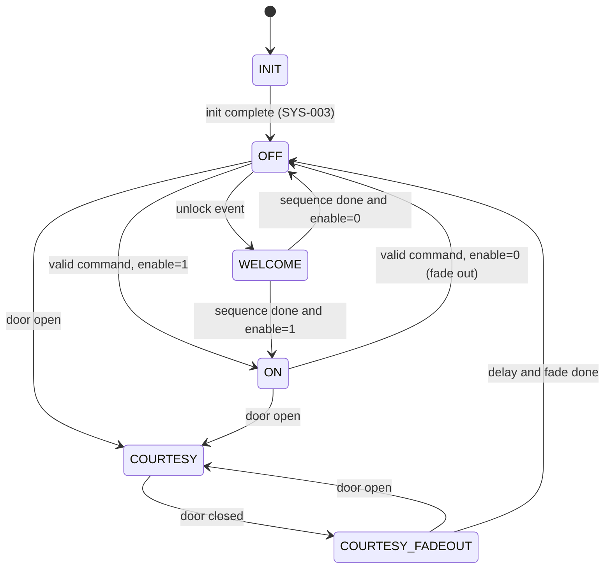
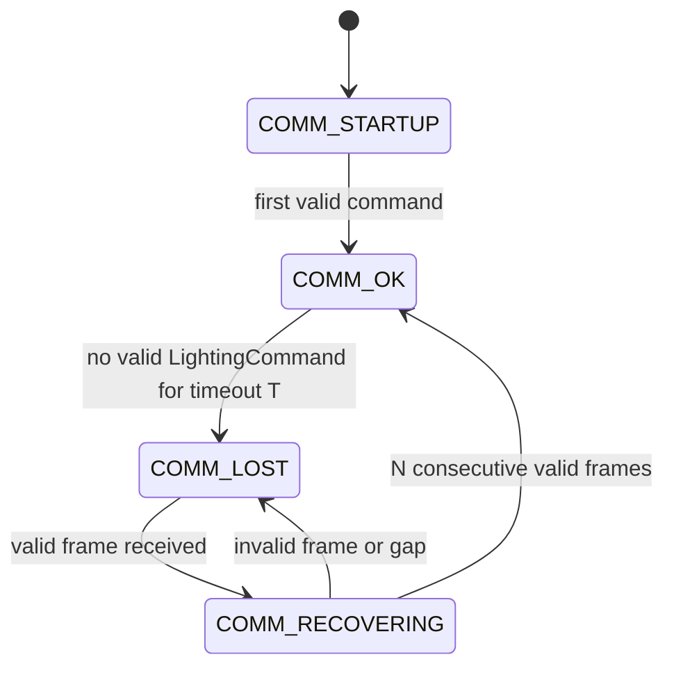
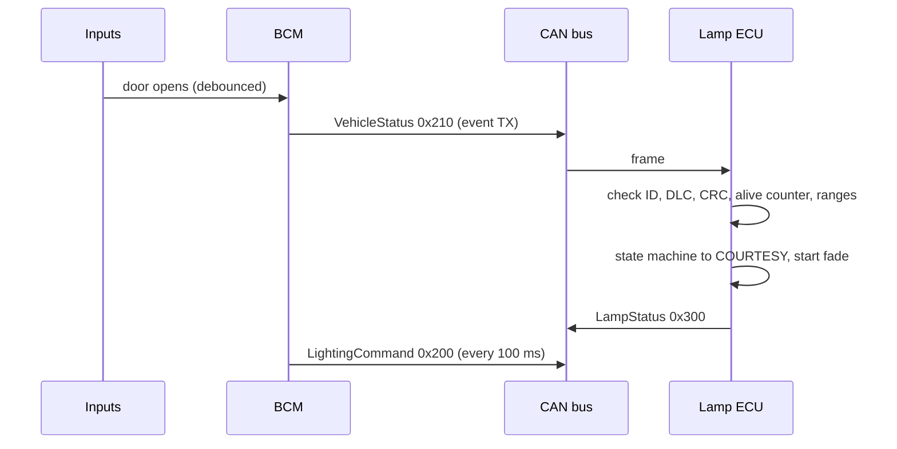

# Automotive Ambient Lighting ECU: Engineering Handbook

**Project:** Two-node CAN ambient lighting system (Lamp ECU on NUCLEO-F446RE, BCM on Blue Pill)
**Document version:** 0.2 (Phase 0 baseline, design re-verified)
**Date:** 2026-10-21
**Owner:** Karim
**Status:** Phase 0 not yet executed. Nothing in this document has been tested on your hardware.

---

## 0. How to use this handbook

1. Execute the steps in order. Do not skip Phase 0.
2. Every step has the same shape: **Why**, **Do**, **Expected result**, **If it fails**, **Evidence to keep**.
3. Keep evidence (screenshots, logs, photos, measurements) in `docs/validation-reports/phase0/`. Later claims in your README must point to this evidence.
4. Tags used in this document:

| Tag | Meaning |
|---|---|
| **[V]** | Verified on 2026-10-21 against an external source (see section 1.2 for the source quality) |
| **[B]** | Must be verified on your bench or in your installed tools. I cannot confirm it from here |
| **[D]** | Project-defined design decision or target. It is not an automotive standard |

5. **Scope statement (applies to the whole project):** this is an educational prototype. It is AUTOSAR-inspired in its layering and vocabulary. It is not an AUTOSAR implementation, not ISO 26262 compliant, and not intended for connection to a vehicle electrical system.

---

## 1. Design re-verification

### 1.1 Corrections to my earlier plan

You asked me to verify the design again. I found the following errors or weak points in my first message. They are fixed in this document.

| # | What I said earlier | Correction | Impact |
|---|---|---|---|
| C1 | "Many Blue Pill boards carry a 1.5 kΩ pull-up on PA12" | The value on R10 varies by board. Many boards ship with 10 kΩ (a known manufacturing error for USB), some with 1.5 kΩ. Either way it is a pull-up to 3.3 V on PA12 (USB D+). | Measure R10 on your board. It only matters for CAN if you use PA11/PA12. This design uses PB8/PB9, so PA11/PA12 stay unused. |
| C2 | "Use 2N7000 or BSS138 as LED driver" | 2N7000 has a gate threshold that can reach about 3 V at the worst case, which is marginal with a 3.3 V gate drive. Confirm on the datasheet of the exact part you buy. | Baseline driver is now an NPN transistor (2N3904 or BC547) with a base resistor. BSS138 stays as an alternative. 2N7000 is removed from the BOM. |
| C3 | "F446RE CAN1 candidate pins: PA11/PA12, PB8/PB9, PD0/PD1" | PD0/PD1 exist as CAN1 options on larger packages, but the NUCLEO-F446RE uses a 64-pin part where they are not available. | Only PA11/PA12 and PB8/PB9 are candidates on your Lamp ECU. |
| C4 | BOM said 5 push buttons, and later I called the unlock input "a fifth button" | Door, enable, mode, brightness, color, and unlock are six inputs. | BOM now lists 6 inputs. The door input should be a toggle or slide switch, which models a door state better than a momentary button. |
| C5 | I did not mention the Nucleo clock source | On NUCLEO-F446RE the HSE is an 8 MHz signal produced by the ST-LINK part (MCO), used in bypass mode. If the ST-LINK is not powered, the HSE is absent. | Always power the Lamp ECU from its ST-LINK USB port. Do not power it from E5V alone. |
| C6 | I offered "use the Nucleo's own ST-LINK to program the Blue Pill" | That is possible (remove the CN2 jumpers, wire CN4), but it disconnects the Nucleo's own MCU from its programmer while you do it. Every flash cycle would need jumper changes. | Buy a separate ST-LINK/V2 for the BCM. Treat the CN4 method as a fallback only. |
| C7 | I did not state how to handle the RS pin | On SN65HVD230 the RS pin selects the mode. A strong pull-down to GND gives high-speed mode. Do not leave it floating. | Wiring step now ties RS to GND (or confirms the module already does). |

### 1.2 Verification log

Source quality, stated honestly: I could not open UM1724 (Nucleo-64 user manual) or RM0008 (STM32F1 reference manual) directly. For those I relied on ST community posts that quote them, plus multiple independent reports. The TI datasheet text for SN65HVD230 was retrieved directly. Anything marked [B] must be checked against the documents installed on your machine.

| Claim | Status | Basis |
|---|---|---|
| On STM32F103 low/medium/high/XL density parts, USB and bxCAN share a dedicated 512-byte SRAM and cannot be used at the same time | **[V]** | RM0008 text quoted in ST community and 21ic threads |
| STM32F103C8 CAN1 default pins are PA11/PA12, shared with USB D-/D+. Remap to PB8/PB9 is available on the C8 package | **[V]** | Multiple community reports of working PB8/PB9 use on Blue Pill. CubeMX shows the option **[B]** |
| Blue Pill USB D+ line (PA12) has a pull-up resistor R10, shipped as 10 kΩ on many boards and 1.5 kΩ on others | **[V]** | Multiple independent reports |
| SN65HVD230: 3.3 V supply (recommended 3 V to 3.6 V), logic input VIH 2 V, RS pin modes (strong pull-down: high speed, 10 kΩ to 100 kΩ to GND: slope control, strong pull-up: standby), Vref pin 5 outputs VCC/2, ISO 11898-2 compatible physical layer | **[V]** | TI datasheet text |
| STM32F4 CAN1 pin options include PA11/PA12, PB8/PB9 (AF9) | **[V]** | Pin lists from embassy-stm32 and ST community posts |
| NUCLEO-F446RE HSE comes from ST-LINK MCO, bypass mode, solder bridge SB50 in the path | **[V]** | ST community posts quoting UM1724 |
| To use the Nucleo-64 ST-LINK for an external target: remove both CN2 jumpers, wire CN4 (pin 2 SWCLK, pin 3 GND, pin 4 SWDIO, pin 5 NRST, pin 1 VDD_TARGET reference), power the target separately | **[V]** | ST community and mbed threads |
| HAL CAN API names: `HAL_CAN_Init`, `HAL_CAN_ConfigFilter`, `HAL_CAN_Start`, `HAL_CAN_AddTxMessage`, `HAL_CAN_GetRxMessage`, `HAL_CAN_ActivateNotification`, `HAL_CAN_RxFifo0MsgPendingCallback`, `HAL_CAN_ErrorCallback`, loopback and silent modes | **[V]** for the API family (F0, F2, F3, F7 HAL sources). **[B]** for your installed F1 and F4 packages | HAL driver sources |
| F4 bxCAN has 28 filter banks shared between CAN1 and CAN2 (split by `SlaveStartFilterBank`). F103 has a single bxCAN with fewer banks (14, check RM0008) | F4: **[V]**. F1 count: **[B]** | embassy-stm32 and STM32World wiki |
| F1 HAL remap macro for PB8/PB9 is `__HAL_AFIO_REMAP_CAN1_2()` | **[B]** | Check the CubeMX-generated `HAL_CAN_MspInit` |
| F446 APB1 clock is 45 MHz when SYSCLK is 180 MHz (APB1 prescaler 4) | **[B]** | General knowledge, ST community example shows APB1 = SYSCLK/4. Confirm in CubeMX clock tab |
| Bit timing arithmetic (section 4.3) | **[D]** computed by me | Recompute with your actual clock tree. Confirm bitrate by measurement |
| TIM3 CH1/CH2/CH3 on PA6/PA7/PB0 (AF2), Nucleo labels D12/D11/A3 | **[B]** | Confirm in CubeMX and the UM1724 pin tables |
| LD2 user LED on PA5, USART2 (PA2/PA3) routed to ST-LINK virtual COM port | **[B]** | Standard for NUCLEO-F446RE, confirm in UM1724 |
| Blue Pill user LED on PC13, active low | **[B]** | Common, but board variants exist |
| CRC-8 SAE-J1850 parameters (poly 0x1D, init 0xFF, xorout 0xFF) check value for `"123456789"` is 0x4B | **[B]** | From the public CRC catalogue as I recall it. Verify with a host tool before relying on it |
| AUTOSAR statements in section 10 (stack availability for STM32F446RE, tooling licensing) | **Not verified** | Requires vendor inquiry. Phase 8 handles this as a time-boxed investigation |

### 1.3 Baseline design decisions

All of these are **[D]**. Each has a reason and a cost.

| ID | Decision | Reason | Trade-off |
|---|---|---|---|
| D-01 | Cooperative superloop with a 1 ms tick, no RTOS | Predictable, easy to unit test, mirrors cyclic task scheduling | No preemption. Long operations in one task delay the others. Rule: no blocking calls in tasks |
| D-02 | CAN bitrate 500 kbit/s, fallback 125 kbit/s | 500 kbit/s is typical for body and powertrain networks and is easy to reach on both nodes (section 4.3) | Needs clean wiring. Fall back to 125 kbit/s only to isolate wiring faults |
| D-03 | Both nodes use CAN on PB8/PB9 | Avoids the USB pin conflict on the Blue Pill. Same pin pair on both nodes simplifies wiring and documentation | PB8/PB9 are I2C1 pins and Arduino header pins on the Nucleo. Do not use I2C1 in this project |
| D-04 | Use HSE crystal or the Nucleo HSE bypass, never HSI, for CAN | CAN bit timing needs an accurate clock. HSI is nominally about 1 percent at 25 °C and drifts | Nucleo needs ST-LINK USB power for its clock |
| D-05 | RGB LED: common anode on 5 V, one NPN low-side switch per channel, PWM active high | Green and blue LED dies need about 3 V, so a 3.3 V supply leaves almost no headroom for a current-limiting resistor. A 5 V rail fixes that and resembles a real low-side lamp driver | Needs a 5 V source (Nucleo 5V pin) and 3 extra transistors |
| D-06 | Add an alive counter and a CRC-8 to LightingCommand | Detects stale, frozen, and corrupted payloads at application level | **E2E-inspired only. This is not AUTOSAR E2E.** It does not protect against every CAN fault |
| D-07 | After communication timeout, the lamp fades to OFF and stays OFF until recovery | Ambient lighting is a comfort function. Holding the last state hides the failure | Product-level behavior is a design choice, not a standard |
| D-08 | One shared protocol module (`firmware/common/`) used by both ECUs and the host tests | A single definition of the signal layout prevents the two nodes from disagreeing | Requires include path setup in both CubeIDE projects |
| D-09 | Host unit tests: Unity (C) built with CMake | Runs on the PC, no hardware needed, fast feedback | You must keep hardware-independent logic free of HAL headers |
| D-10 | Separate ST-LINK/V2 for the Blue Pill | See correction C6 | Small extra cost |
| D-11 | Independent bus observer (USB-CAN adapter, or a spare ESP32 with a third transceiver) | Without it, UART logs only show what each node believes | Extra hardware. If you have neither, the automated tests degrade to UART evidence and you must say so in the README |
| D-12 | Application and service code never includes HAL headers. Only the Drivers layer touches HAL | Testability and clean layering | Needs thin wrapper functions |

---

## 2. System architecture

### 2.1 Block diagram

```
 [6 inputs: door switch, enable, mode, brightness, color, unlock]
                    |
        +-----------+-----------+            UART (BCM logs)
        | BCM: Blue Pill        |------------> USB-UART adapter -> PC
        | STM32F103C8T6 [B]     |
        +-----------+-----------+
                    | CAN_TX PB9 / CAN_RX PB8 (3.3 V logic)
             [SN65HVD230 #1]
                    | CANH / CANL, twisted pair, 120 ohm at each END
             [SN65HVD230 #2] ------ (optional) USB-CAN adapter or ESP32 sniffer -> PC (Python)
                    | CAN_TX PB9 / CAN_RX PB8
        +-----------+-----------+            UART via ST-LINK VCP
        | Lamp ECU: NUCLEO-F446RE|-----------> PC (logs)
        +-----------+-----------+
                    | TIM3 PWM x3
            [3x NPN low-side switch]
                    |
          RGB LED, common anode on 5 V
```

The observer is a passive third node on the bus. Keep stubs short. The two 120 Ω resistors belong at the two physical ends of the bus only.

### 2.2 Software layering (Lamp ECU, BCM mirrors it)

```
+---------------------------------------------------------------+
| Application    LampControl | LampStateMachine | FadeEngine      |
|                CommandValidator | FaultManager                  |
+---------------------------------------------------------------+
| Services       Scheduler (1 ms tick) | TimeoutMonitor |         |
|                Diagnostics | Log                                |
+---------------------------------------------------------------+
| Communication  Protocol (pack/unpack, CRC) | RxQueue |         |
|                TxScheduler | ComStatus                          |
+---------------------------------------------------------------+
| Drivers        LedPwm | CanDrv (HAL wrapper) | UartDrv         |
+---------------------------------------------------------------+
| STM32 HAL and CubeMX-generated Core (hardware specific only)    |
+---------------------------------------------------------------+
```

Rules:

1. A layer calls only the layer directly below it.
2. Application and Services never include `stm32*_hal*.h`.
3. Hardware-independent modules (`protocol`, `crc8`, `color`, `fade`, `validator`, `lamp_fsm`, `timeout_monitor`, `debounce`, `bcm_cmd`) must compile and run on a PC.
4. No `HAL_Delay` in application behavior. All timing uses the 1 ms tick.
5. An **application function** decides what should happen (for example, "fade to 40 percent over 500 ms"). A **hardware driver** performs how it happens on this chip (for example, "write this value to the TIM3 compare register").

### 2.3 Superloop timing model [D]

| Task | Period | Notes |
|---|---|---|
| Tick service | 1 ms | SysTick driven (`HAL_GetTick`) |
| CAN RX processing | Each loop pass | The interrupt only copies frames into a ring buffer |
| Input scan and debounce (BCM) | 10 ms | |
| Fade engine and PWM update (Lamp) | 10 ms | |
| Lamp state machine | 10 ms | |
| Command TX (BCM) | 100 ms cyclic | Plus immediate TX on door change |
| Status TX (Lamp) | 100 ms | |
| Diagnostic TX (Lamp) | 500 ms | |
| Timeout monitor | 10 ms | |
| UART log flush | Each loop pass | Non-blocking, buffered |

All of these numbers are **[D]** targets. Phase 1 finalizes them. Phase 7 measures whether the firmware actually meets them.

### 2.4 Lamp state machine (draft)



### 2.5 Communication fault state machine (draft)



In `COMM_LOST` the lamp fades to OFF and stays OFF (D-07). The values of T and N are Phase 1 decisions. Proposed starting values: T = 300 ms (three missed 100 ms cycles) and N = 2.

### 2.6 Command flow (draft)



---

## 3. Requirements outline (full SRS is written in Phase 1)

Priority: M = mandatory, O = optional, A = advanced.
Verification: T = test, I = inspection, D = demonstration, A = analysis.
`TC-xxx` ids are planned test cases. They are placeholders until Phase 7.

| ID | Requirement | Pri | Ver | Planned test |
|---|---|---|---|---|
| SYS-001 | The BCM shall transmit LightingCommand cyclically | M | T | TC-001 |
| SYS-002 | The Lamp ECU shall validate every received command before applying it | M | T | TC-002 |
| SYS-003 | The Lamp ECU shall keep the lamp OFF until the first valid command | M | T | TC-003 |
| SYS-004 | Both nodes shall use one documented bitrate and bit timing | M | I, T | TC-004 |
| LMP-001 | ON and OFF control | M | T | TC-010 |
| LMP-002 | RGB output through three hardware PWM channels | M | T, I | TC-011 |
| LMP-003 | Brightness 0 to 100 percent scaling | M | T | TC-012 |
| LMP-004 | Modes STATIC, WELCOME, COURTESY as a minimum | M | T | TC-013 |
| LMP-005 | Non-blocking fades, no `HAL_Delay` in sequences | M | I, T | TC-014 |
| LMP-006 | Door open triggers courtesy light, door close triggers delayed fade-out | M | T | TC-015 |
| LMP-007 | Breathing mode | O | D | TC-016 |
| COM-001 | Communication-loss behavior after the timeout T | M | T | TC-020 |
| COM-002 | Out-of-range values rejected, previous valid state retained | M | T | TC-021 |
| COM-003 | Wrong identifier or wrong DLC ignored | M | T | TC-022 |
| COM-004 | Alive counter and CRC check | O | T | TC-023 |
| COM-005 | LampStatus transmitted cyclically | M | T | TC-024 |
| COM-006 | Documented recovery rule after communication resumes | M | T | TC-025 |
| COM-007 | Error-passive and bus-off handling with recovery | A | T | TC-026 |
| DIA-001 | Counters for valid, rejected, and timed-out messages | M | T | TC-030 |
| DIA-002 | Fault bits reported in DiagnosticStatus | M | T | TC-031 |
| BCM-001 | Input debouncing | M | T | TC-040 |
| BCM-002 | Command generation independent of HAL | M | T | TC-041 |
| TST-001 | Every requirement has a verification method in the traceability matrix | M | I | n/a |
| TST-002 | Host unit tests for hardware-independent modules | M | T | n/a |
| TST-003 | Automated runner with JSON report | O | T | n/a |
| DOC-001 | README states the AUTOSAR scope and non-compliance | M | I | n/a |

Quantitative thresholds (timeouts, fade times, debounce time, PWM frequency, resolution) are set in Phase 1 and labeled project-defined targets.

### 3.1 Feature tiers

| Tier | Features |
|---|---|
| **Mandatory** | ON/OFF, RGB, brightness, STATIC/WELCOME/COURTESY modes, non-blocking fade, door events, LampStatus, timeout and recovery, invalid-message rejection, diagnostic counters, host unit tests, requirement traceability |
| **Optional** | Breathing mode, alive counter and CRC, Python test runner with JSON report, PC CAN monitor |
| **Advanced** | Bus-off and error-passive handling, CAN wiring fault injection, GitHub Actions running host tests, a time-boxed investigation of a real AUTOSAR stack |

---

## 4. CAN interface draft

**Everything in this section is a DRAFT [D]. It is finalized in Phase 5.** The identifiers and layouts are project-defined. They are not OEM or standard assignments.

### 4.1 Message set

| Message | ID (std 11-bit) | DLC | Sender | Receiver | Trigger | Timeout at receiver |
|---|---|---|---|---|---|---|
| LightingCommand | 0x200 | 8 | BCM | Lamp | Cyclic 100 ms | 300 ms (proposed) |
| VehicleStatus | 0x210 | 3 | BCM | Lamp | Cyclic 100 ms plus immediate on change | 300 ms (proposed) |
| LampStatus | 0x300 | 4 | Lamp | BCM | Cyclic 100 ms | BCM only logs |
| DiagnosticStatus | 0x310 | 8 | Lamp | BCM (and observer) | Cyclic 500 ms | not monitored |

Lower identifier means higher arbitration priority. Commands outrank status, which outranks diagnostics.

A CAN identifier is a message label. It is not an application command value. Do not use the ID to carry mode or color.

### 4.2 Signal layouts (byte order: Intel, little endian)

**LightingCommand 0x200**

| Byte | Bits | Signal | Type | Range | Default | Notes |
|---|---|---|---|---|---|---|
| 0 | 0 to 3 | AliveCounter | unsigned | 0 to 15 | 0 | Increments by 1 each transmission, wraps 15 to 0 |
| 0 | 4 | LampEnable | unsigned | 0 or 1 | 0 | |
| 0 | 5 to 7 | Reserved | unsigned | 0 | 0 | Must be 0, otherwise reject |
| 1 | 0 to 7 | LightingMode | unsigned | 0 to 2 (3 if breathing implemented) | 0 | 0 STATIC, 1 WELCOME, 2 COURTESY, 3 BREATHING (optional). Other values rejected |
| 2 | 0 to 7 | Red | unsigned | 0 to 255 | 0 | |
| 3 | 0 to 7 | Green | unsigned | 0 to 255 | 0 | |
| 4 | 0 to 7 | Blue | unsigned | 0 to 255 | 0 | |
| 5 | 0 to 7 | BrightnessPercent | unsigned | 0 to 100 | 0 | Greater than 100 rejected |
| 6 | 0 to 7 | FadeTime | unsigned, factor 10 ms | 0 to 255 (0 to 2.55 s) | 0 | |
| 7 | 0 to 7 | Crc8 | unsigned | 0 to 255 | n/a | CRC-8 over bytes 0 to 6 (see below) |

**VehicleStatus 0x210**

| Byte | Bits | Signal | Range | Notes |
|---|---|---|---|---|
| 0 | 0 | DoorOpen | 0 closed, 1 open | |
| 0 | 1 to 2 | VehicleLockState | 0 LOCKED, 1 UNLOCKED | Welcome light triggers on the transition LOCKED to UNLOCKED |
| 0 | 3 to 7 | Reserved | 0 | |
| 1 | 0 to 3 | AliveCounter | 0 to 15 | |
| 2 | 0 to 7 | Crc8 | | Over bytes 0 and 1 |

**LampStatus 0x300**

| Byte | Signal | Notes |
|---|---|---|
| 0 | ActiveMode | Mode currently executing |
| 1 | LampState | 0 INIT, 1 OFF, 2 ON, 3 WELCOME, 4 COURTESY, 5 COURTESY_FADEOUT, 6 COMM_LOST |
| 2 | OutputBrightnessPercent | Actual output, not requested |
| 3 | AliveCounter (bits 0 to 3) | |

**DiagnosticStatus 0x310**

| Bytes | Signal | Notes |
|---|---|---|
| 0 to 1 | RxValidCount | uint16, wraps |
| 2 to 3 | RxRejectedCount | uint16, wraps |
| 4 to 5 | TimeoutCount | uint16, wraps |
| 6 | FaultBits | bit0 CMD_TIMEOUT active, bit1 INVALID_VALUE seen, bit2 CRC_FAIL seen, bit3 ALIVE_FAIL seen, bit4 BUSOFF occurred |
| 7 | EcuState | Same encoding as LampState |

**CRC-8 [D, check value is [B]]:** polynomial 0x1D, initial value 0xFF, final XOR 0xFF, no reflection. This is the SAE-J1850 style CRC. It is **E2E-inspired, not AUTOSAR E2E**. Unit test vector: CRC of the ASCII bytes `123456789` should be 0x4B. Verify that value with a trusted host tool before you hard-code it into a test.

### 4.3 Bit timing (computed, to be confirmed in Phase 5) [D][B]

Formula: `bitrate = f_APB1 / (Prescaler x (1 + BS1 + BS2))`

| Node | f_APB1 | Prescaler | BS1 | BS2 | Total tq | Bitrate | Sample point |
|---|---|---|---|---|---|---|---|
| Lamp ECU (F446RE, SYSCLK 180 MHz, APB1 prescaler 4) | 45 MHz | 5 | 15 | 2 | 18 | 500 kbit/s | 16/18 = 88.9 percent |
| BCM (F103, SYSCLK 72 MHz, APB1 prescaler 2) | 36 MHz | 4 | 15 | 2 | 18 | 500 kbit/s | 16/18 = 88.9 percent |

Both nodes use SJW = 1 tq. Both use the same time quantum (45/5 = 36/4 = 9 MHz). If CubeMX shows a different APB1 clock on your boards, recompute with the formula. Cross-check with an online bit-timing calculator, then measure the real bitrate on the bus (logic analyzer or USB-CAN adapter).

### 4.4 Receiver validation order (Lamp ECU)

For every received frame:

1. Identifier is one of the expected IDs, otherwise ignore (COM-003).
2. DLC equals the expected length, otherwise reject.
3. CRC-8 matches, otherwise reject and set CRC_FAIL.
4. AliveCounter changed from the previous frame (and is not a repeated or frozen value), otherwise reject and set ALIVE_FAIL.
5. All signals are inside their valid range and reserved bits are zero, otherwise reject and set INVALID_VALUE.
6. Only now update the application command state and reset the timeout.

A rejected frame never changes the application state and never resets the timeout. That is how stale or malformed frames are prevented from silently overriding valid state.

---

## 5. Hardware design

### 5.1 Candidate pin assignment **[B]**

None of these pins are final until you confirm them in CubeMX and the board documents.

**Lamp ECU (NUCLEO-F446RE)**

| Function | Pin | Notes |
|---|---|---|
| CAN1_RX | PB8 (Arduino D15) | AF9. Alternative: PA11 |
| CAN1_TX | PB9 (Arduino D14) | AF9. Alternative: PA12 |
| TIM3_CH1 (Red) | PA6 | AF2, Arduino D12 |
| TIM3_CH2 (Green) | PA7 | AF2, Arduino D11 |
| TIM3_CH3 (Blue) | PB0 | AF2, Arduino A3 |
| USART2 TX/RX | PA2 / PA3 | ST-LINK virtual COM port |
| Debug LED | PA5 (LD2) | |
| Keep free | PB8/PB9 are also I2C1 pins | Do not use I2C1 |

All three PWM channels on one timer share one period, so the three colors are synchronized.

**BCM (Blue Pill)**

| Function | Pin | Notes |
|---|---|---|
| CAN1_RX | PB8 | Requires the AFIO CAN remap to PB8/PB9 |
| CAN1_TX | PB9 | |
| USART1 TX/RX | PA9 / PA10 | To the USB-UART adapter (crossed) |
| Door switch | PA0 | Active low, internal pull-up |
| Lamp enable | PA1 | Active low |
| Mode select | PA2 | Active low |
| Brightness step | PA3 | Active low |
| Color select | PA4 | Active low |
| Unlock/approach | PA5 | Active low |
| Status LED | PC13 | Active low on most boards |
| Do not use | PA11/PA12 (USB), PA13/PA14 (SWD) | |

### 5.2 CAN physical layer wiring

Wire with all power OFF.

| From | To | Note |
|---|---|---|
| Transceiver #1 VCC | Blue Pill 3V3 | 3.3 V only |
| Transceiver #1 GND | Blue Pill GND | |
| Transceiver #1 D (TXD) | BCM PB9 | |
| Transceiver #1 R (RXD) | BCM PB8 | |
| Transceiver #1 RS | GND | High-speed mode. Do not leave floating (C7). Many modules already do this |
| Transceiver #1 Vref (pin 5) | not connected | |
| Transceiver #2 VCC | Nucleo 3V3 | |
| Transceiver #2 GND | Nucleo GND | |
| Transceiver #2 D (TXD) | Lamp PB9 | |
| Transceiver #2 R (RXD) | Lamp PB8 | |
| Transceiver #2 RS | GND | |
| CANH #1 | CANH #2 | Twisted pair, short |
| CANL #1 | CANL #2 | |
| GND (board 1) | GND (board 2) | Common reference |
| 120 Ω | across CANH and CANL at transceiver #1 | Unless an onboard resistor is already present |
| 120 Ω | across CANH and CANL at transceiver #2 | Unless an onboard resistor is already present |

Do not use 5 V transceivers (TJA1050, MCP2551) on these 3.3 V MCUs without level handling.

Termination check (power OFF, nothing else connected to the bus): measure resistance between CANH and CANL.

| Reading | Meaning |
|---|---|
| about 60 Ω | Two 120 Ω terminations in parallel. Correct |
| about 120 Ω | One termination only |
| open circuit | No termination |
| about 40 Ω | Three terminations. Remove one |

### 5.3 RGB LED driver (common anode, 5 V, low-side NPN)

Per channel:

```
+5V ---- LED anode (common)
         LED cathode (R, G or B) ---- R_led ---- NPN collector
                                                 NPN emitter ---- GND
MCU PWM pin ---- 1 kΩ ---- NPN base
                  base ---- 100 kΩ ---- GND   (keeps the transistor off while the pin floats at reset)
```

| Channel | Assumed Vf | R_led | Estimated current |
|---|---|---|---|
| Red | about 2.0 V | 330 Ω | (5 - 2.0 - 0.2) / 330 = about 8.5 mA |
| Green | about 3.0 V | 220 Ω | (5 - 3.0 - 0.2) / 220 = about 8.2 mA |
| Blue | about 3.0 V to 3.3 V | 220 Ω | about 6.8 to 8.2 mA |

The 0.2 V is an assumed NPN saturation voltage. Vf varies between LED parts. Check your LED datasheet and measure the real current with a multimeter in series before you trust these numbers.

Why not drive the LED directly from a GPIO: a GPIO has a per-pin and a package-total current limit, and at 3.3 V the green and blue dies leave only a few tenths of a volt across a resistor, so the current would be unpredictable.

PWM polarity: with this circuit, PWM high turns the transistor on, so duty cycle maps directly to brightness. With a common-cathode LED and a high-side or direct drive the mapping is the same for active-high drive. If you ever use a P-channel high-side switch, polarity inverts and the duty must be inverted in the driver, not in the application.

Perceived brightness is not linear in duty cycle. A gamma lookup table is a Phase 3 refinement. Do not add it before the linear version works.

Do not connect LED strips until this prototype is validated. A strip draws far more current than the Nucleo 5 V pin and these transistors can supply.

### 5.4 Bill of materials

| Item | Qty | Purpose | Class | Electrical notes | Alternatives |
|---|---|---|---|---|---|
| NUCLEO-F446RE | 1 | Lamp ECU | Essential | Power from ST-LINK USB (C5) | none |
| Blue Pill (verify MCU) | 1 | BCM | Essential | 3.3 V logic | Any other bxCAN board |
| ST-LINK/V2 | 1 | Flash and debug BCM | Essential | SWD, 3.3 V | Nucleo CN4 method (fallback), USB-UART bootloader (no debug) |
| USB-UART adapter, 3.3 V logic | 1 | BCM logs | Essential | Do not connect its VCC to the board if the board is powered otherwise | none |
| SN65HVD230 module | 2 | CAN physical layer | Essential | 3.3 V supply, check termination and RS wiring | TJA1051T/3 (check logic supply pin) |
| 120 Ω resistor, 1/4 W | 2 | Termination | Essential | Skip if modules already have verified 120 Ω | none |
| RGB LED 5 mm, common anode | 1 | Output | Essential | Verify polarity (step 0.6) | Common cathode needs a different driver topology |
| NPN 2N3904 or BC547 | 3 | LED channel switches | Essential | Ic max well above 10 mA | BSS138 module |
| Resistors 330 Ω, 220 Ω, 1 kΩ, 100 kΩ | 1, 2, 3, 3 | LED and base network | Essential | 1/4 W | none |
| Toggle or slide switch | 1 | Door state | Essential | | Push button |
| Push buttons | 5 | Enable, mode, brightness, color, unlock | Essential | Internal pull-ups, wired to GND | none |
| Breadboard and jumper wires | 1 set | Wiring | Essential | | Perfboard later |
| Twisted pair for CANH/CANL | 1 | Bus | Essential | Keep under about 1 m on the bench | Two jumpers twisted by hand |
| Multimeter | 1 | Termination, current, continuity | Essential | | none |
| USB-CAN adapter (CANable class) | 1 | Independent observer, Python tests | Strongly recommended | Check firmware (slcan or gs_usb) matches python-can | ESP32 with TWAI plus a third transceiver |
| Logic analyzer or oscilloscope | 1 | PWM and CAN timing | Optional | | none |

What you can do without any extra purchase: all firmware logic, host unit tests, documentation, and single-node CAN loopback (bxCAN loopback and silent modes). A lone node on a real bus gets no acknowledgement, so loopback does not prove physical-layer correctness.

---

## 6. Phase 0 step-by-step: feasibility, toolchain, hardware audit

Goal of Phase 0: prove that your toolchain, programmers, clocks, UART logging, and parts match the assumptions in this document, before any CAN or lighting work. A wrong assumption found now costs minutes. Found in Phase 5 it costs days.

### Step 0.1 Create the repository skeleton

**Why:** every later artifact (requirements, logs, test reports) needs a stable home, and Git history is part of your portfolio evidence.

**Do (Git Bash, Linux, or macOS shell):**

```bash
mkdir automotive-ambient-lighting-ecu
cd automotive-ambient-lighting-ecu
git init
mkdir -p docs/requirements docs/architecture docs/hardware docs/communication \
         docs/test-plans docs/validation-reports/phase0 \
         firmware/common firmware/lamp_ecu firmware/bcm \
         tests/unit tests/integration tests/system \
         tools/can_monitor tools/test_runner \
         hardware/schematics hardware/wiring hardware/bom
```

Create a `.gitignore` containing:

```
# CubeIDE build output
Debug/
Release/
# Host test build output
build/
# Python
__pycache__/
*.pyc
.pytest_cache/
# Test run output (reports you want to keep go in docs/validation-reports/)
tools/test_runner/output/
```

Commit the `.ioc` files and all hand-written sources. Do not commit build output.

```bash
git add .
git commit -m "chore: repository skeleton"
```

(Empty folders are not tracked by Git. Add an empty `.gitkeep` file to any folder you want to keep before its first real file.)

**Expected result:** a clean repo with one commit.
**Evidence to keep:** none needed.

### Step 0.2 Record your toolchain versions

**Why:** HAL API names and CubeMX behavior change between package versions. Every later debugging session starts with "which version".

**Do:**

1. Open STM32CubeIDE. Help, About STM32CubeIDE. Note the version.
2. Help, Manage Embedded Software Packages. Note the installed **STM32Cube MCU Package for STM32F4** and **for STM32F1** versions. Install both if missing.
3. In a terminal, run and note the output:

```bash
git --version
python --version
pip --version
gcc --version
cmake --version
```

If `gcc` or `cmake` are missing, install them now (Linux: package manager. Windows: MSYS2 with `mingw-w64-x86_64-gcc` and `cmake`, or use WSL). You need them for the host unit tests in Phase 2.

4. Install the Python packages used later:

```bash
pip install pyserial python-can pytest
```

5. Install STM32CubeProgrammer if it is not already bundled with your CubeIDE. You will use it for step 0.3.

**Expected result:** all commands print versions with no errors.
**If it fails:** record the exact error message. Do not work around a missing compiler by skipping host tests.
**Evidence to keep:** a text file `docs/validation-reports/phase0/toolchain-versions.txt` with all versions.

### Step 0.3 Identify the real MCU on the Blue Pill

**Why:** many Blue Pill boards carry parts that are not genuine STM32F103C8T6 (different flash size, different debug behavior). CubeMX target, flash size, and debug behavior depend on this.

**Do:**

1. Read the chip marking under good light or a magnifier. Photograph it.
2. Set the two BOOT jumpers on the Blue Pill to 0 (boot from flash).
3. Connect the ST-LINK/V2 to the Blue Pill SWD header. **Match pins by the silkscreen labels, not by position** (header order differs between board variants). Connect GND, SWCLK, SWDIO. Power the Blue Pill from one source only: either its micro-USB, or the ST-LINK 3.3 V pin, not both.
4. Open STM32CubeProgrammer, select ST-LINK, mode normal, press Connect.
5. Read the target information shown: **Device ID**, **Flash size**, **Device name**.
6. Open the Device Memory tab, read 4 bytes at address `0x1FFFF7E0`. The 16-bit value is the flash size in KB (0x0040 means 64 KB, 0x0080 means 128 KB). [B]
7. Read the 96-bit unique ID (shown in the information panel or at the UID address in the reference manual).

**Expected result:** Device ID 0x410 (medium-density STM32F103) and a flash size of 64 KB or 128 KB. [B]

**Decision rules:**

| Observation | Action |
|---|---|
| Connects, ID 0x410, 64 KB | Proceed. CubeMX target: STM32F103C8Tx |
| Connects, ID 0x410, reads 128 KB | Proceed, but **design to fit in 64 KB** so the project stays valid on a genuine C8 part. Record this in the report |
| Connects but device ID or name differs | Possible clone. Record the exact text. CubeIDE may complain on flashing. Do not bypass checks blindly. Send me the exact messages |
| Cannot connect | Check GND first, then SWCLK/SWDIO swap, BOOT0 at 0, power source, try "Connect under reset" with the RESET line wired |

**Evidence to keep:** chip photo, CubeProgrammer screenshot, UID text.

### Step 0.4 Check the Blue Pill USB pull-up (informational)

**Why:** correction C1. This tells you how your board behaves when plugged into a PC, and confirms why this project avoids PA11/PA12.

**Do:** with the board unpowered, measure resistance between the 3V3 rail and PA12. A reading near 1.5 kΩ or 10 kΩ identifies R10's value. Note it.

**Expected result:** about 1.5 kΩ or 10 kΩ. **Consequence:** if you power the Blue Pill from micro-USB, Windows may report an unrecognized USB device. That is harmless for this project. If it annoys you, power the board from the 5V pin or the ST-LINK 3.3 V instead.

### Step 0.5 Inspect the CAN transceiver modules

**Why:** you must know the part, its supply, its termination, and its RS wiring before connecting anything.

**Do (modules unpowered):**

1. Read the IC marking. For an SN65HVD230 in SOIC-8 the package marking is typically `VP230`. [B] Anything marked TJA1050, MCP2551, or similar is a **5 V** device. Do not use it here without level handling.
2. Check the module silkscreen for the supply pin label (3V3 or 5V).
3. Measure resistance between the CANH and CANL pins of the module.
   - About 120 Ω means a termination resistor is fitted (and possibly selectable by a jumper).
   - Open circuit means none.
4. In continuity mode, check whether IC pin 8 (RS) is connected to GND. If it is not, you must tie it to GND yourself.
5. Note whether pin 5 (Vref) is broken out. Leave it unconnected.

**Expected result:** two 3.3 V SN65HVD230 modules, termination status known for each, RS tied to GND or known to need tying.
**Evidence to keep:** photos of both modules and a table of readings.

### Step 0.6 Identify the RGB LED polarity

**Why:** the whole driver circuit in section 5.3 assumes common anode.

**Do:**

1. Identify the longest leg (usually the common pin).
2. Connect +5 V through a **1 kΩ resistor** to the longest leg, and touch GND briefly to each other leg.
   - If each of the three legs lights one color, it is **common anode**. Proceed with section 5.3.
   - If nothing lights, swap: GND through 1 kΩ to the longest leg and +5 V to each other leg. If colors light now, it is **common cathode**. Tell me, because the driver topology changes.

The 1 kΩ resistor keeps the test current around 2 mA, which is safe for any LED.

**Evidence to keep:** which leg is which color (R, G, B) and the polarity result.

### Step 0.7 Smoke test the Lamp ECU (NUCLEO-F446RE)

**Why:** this proves five things at once: CubeIDE builds, the ST-LINK flashes, the HSE clock (bypass) works, the virtual COM port works, and a GPIO works.

**Do:**

1. File, New, STM32 Project. Choose the **Board Selector** tab. Select **NUCLEO-F446RE**. Name the project `lamp_ecu` and set the location to `<repo>/firmware/`. Language C. Accept "Initialize all peripherals with their default mode".
2. In the `.ioc` file:
   - Pinout and Configuration, System Core, RCC: **High Speed Clock (HSE) = BYPASS Clock Source** (C5).
   - System Core, SYS: Debug = Serial Wire (should already be set).
   - Connectivity, USART2: Mode Asynchronous, 115200 baud, 8 data bits, no parity, 1 stop bit.
   - Clock Configuration: PLL source HSE (8 MHz). Set HCLK to 180 MHz and let CubeMX solve it. Confirm APB1 peripheral clock shows 45 MHz and APB1 timer clock shows 90 MHz. [B]
3. Save the `.ioc` to generate code.
4. Create the two files from Appendix A in `Core/Inc/smoke_test.h` and `Core/Src/smoke_test.c`. In CubeIDE, right-click the project, Refresh (F5).
5. Edit `Core/Src/main.c` as shown in Appendix A.
6. Build (hammer icon). Expect **0 errors**. Note any warnings.
7. Connect the Nucleo USB cable to the PC (this also powers the HSE source). Flash with Run.
8. Open a serial terminal on the ST-LINK Virtual COM Port at 115200 8N1. Windows: find the port in Device Manager. Linux: usually `/dev/ttyACM0`. For a terminal you can use PuTTY, the CubeIDE Terminal view, or:

```bash
python -m serial.tools.miniterm <PORT> 115200
```

**Expected result:**

- LED LD2 toggles every 500 ms (a full blink cycle each second).
- The terminal shows a boot line, a clock line, and then one `SMOKE TICK` line per second. For the configuration above the clock line should read `sysclk=180000000 hclk=180000000 pclk1=45000000`. [B]

**If it fails:**

| Symptom | Likely cause | Action |
|---|---|---|
| Build error about unknown `huart2` | Handle name differs | Open `main.c`, find the generated `UART_HandleTypeDef` name, use it in `Smoke_Init` |
| Flashes, no LED, no output | HSE bypass not set, so clock init failed and the code is in `Error_Handler` | Recheck RCC HSE mode and that the board is USB powered |
| LED blinks but no terminal text | Wrong COM port or baud | Check the ST-LINK VCP port number and 115200 |
| Terminal shows garbage | Clock tree not what you think | Compare printed `pclk1` with expectation |
| "No ST-LINK detected" | Cable or driver | Try another data-capable USB cable, install ST-LINK driver |

**Evidence to keep:** build log screenshot, terminal capture, photo of the blinking LED.

### Step 0.8 Smoke test the BCM (Blue Pill)

**Do:**

1. File, New, STM32 Project. Choose the **MCU/MPU Selector** tab. Select **STM32F103C8Tx**. Name the project `bcm`, location `<repo>/firmware/`.
2. In the `.ioc` file:
   - RCC: **High Speed Clock (HSE) = Crystal/Ceramic Resonator**.
   - SYS: **Debug = Serial Wire**. This is critical. If you leave it on "No Debug", the SWD pins are repurposed after reset and you can lock yourself out of the chip.
   - USART1: Asynchronous, 115200, 8N1 (pins PA9 TX, PA10 RX).
   - Clock Configuration: PLL source HSE, PLL multiplier x9, SYSCLK 72 MHz, APB1 prescaler /2. Confirm PCLK1 = 36 MHz.
3. Save to generate code.
4. Add `smoke_test.h` and `smoke_test.c` from Appendix A to `Core/Inc` and `Core/Src`.
5. Edit `main.c` as in Appendix A, passing `&huart1`.
6. Wire the USB-UART adapter: adapter GND to Blue Pill GND, adapter RXD to PA9, adapter TXD to PA10. The adapter must be 3.3 V logic. Do not connect the adapter VCC to the board if the board is powered from another source.
7. Build, flash through the ST-LINK/V2, open the adapter's COM port at 115200 8N1.

**Expected result:**

- The PC13 LED blinks.
- The terminal shows `sysclk=72000000 hclk=72000000 pclk1=36000000` and one tick line per second. [B]

**If it fails:** use the same table as step 0.7. Additionally: if flashing fails right after you changed settings, set BOOT0 high, reset, reflash with CubeProgrammer using "Connect under reset", then set BOOT0 low.

**Evidence to keep:** same as step 0.7.

### Step 0.9 Understand what the printed clock values prove

The `HAL_RCC_Get*Freq` functions compute frequencies from the configuration registers. They do not measure a real oscillator. They are consistent with reality only if the clock switch succeeded. If the HSE had failed to start, `SystemClock_Config` would have called `Error_Handler` and the LED would never blink. So "LED blinks and clock values match" is good evidence that the HSE works, but a bitrate measurement in Phase 5 is the real test of CAN timing.

### Step 0.10 Complete the audit and commit

1. Fill in Appendix B.
2. Move all evidence into `docs/validation-reports/phase0/`.
3. Commit: `git add . && git commit -m "docs: phase 0 hardware audit and smoke tests"`.
4. Send me Appendix B and any error messages.

### Phase 0 acceptance criteria

| # | Criterion | Evidence |
|---|---|---|
| P0-1 | Blue Pill MCU identified (marking, device ID, flash size, UID) | Photo, screenshot |
| P0-2 | CubeIDE and both Cube MCU package versions recorded | `toolchain-versions.txt` |
| P0-3 | Both transceivers identified, supply voltage and termination known | Table, photos |
| P0-4 | RGB LED polarity known | Table |
| P0-5 | Nucleo smoke test passes, clock values recorded | Log, photo |
| P0-6 | Blue Pill smoke test passes, clock values recorded | Log, photo |
| P0-7 | Host compiler and CMake work | `toolchain-versions.txt` |
| P0-8 | Decision recorded on observer hardware (USB-CAN adapter, ESP32, or none) | Appendix B |

Do not start Phase 1 until P0-1 to P0-6 are met.

---

## 7. Roadmap: Phases 1 to 10 as ordered steps

Each phase below is an outline of the steps and the gate. I will give the complete code and detailed instructions for each phase when you reach it, so that every phase is based on what actually happened in the previous one.

### Phase 1: Requirements and architecture

1. Create `docs/requirements/SRS.md`. For each requirement in section 3 write: ID, description, priority, input and expected output, verification method, acceptance criteria, related software component.
2. Rewrite any requirement that contains words like "fast", "smooth", "appropriate". Each must be testable with a number or an observable condition.
3. Fix the project-defined thresholds in a table, each labeled [D]: command cycle, timeout T, recovery count N, debounce time, fade time default, courtesy-off delay, PWM frequency, PWM resolution.
4. Resolve the open decisions: the unlock input behavior, the exact welcome sequence, and the exact courtesy rule.
5. Put the diagrams from section 2 into `docs/architecture/` as Mermaid files and refine them.
6. Create the traceability matrix `docs/test-plans/RTM.csv` with columns: requirement ID, component, verification method, test case ID, status.
7. Tag the baseline: `git tag srs-v0.1`.

**Gate:** you approve the threshold table and safe-state behavior. Every requirement is testable.

### Phase 2: Repository and software architecture

1. Move the two CubeIDE projects into their final locations if they are not already there.
2. Create the folders `Application`, `Services`, `Communication`, `Drivers_App` inside each firmware project. Add them as source folders and add their paths to the project include paths (project properties, C/C++ General, Paths and Symbols).
3. Add `firmware/common/` to both projects as a linked folder (so one copy of `protocol` and `crc8` serves both ECUs and the host tests).
4. Write interface headers only (function signatures, types, error codes, Doxygen comments) for every module in the layering diagram. No implementations yet.
5. Create the host test build: `tests/unit/CMakeLists.txt` with Unity and one dummy test that passes. Run it from a clean clone.
6. Write `docs/architecture/coding-conventions.md`: naming (`module_verb`), fixed-width integer types, one error-code enum, no magic numbers (named constants in a config header), logging format.
7. Define the Git workflow: `main` always builds, feature branches named `feat/<requirement-id>`, commit messages start with the requirement ID.

**Gate:** both firmware projects build. The dummy host test runs. Interfaces are reviewed.

### Phase 3: Lamp ECU base firmware (no CAN yet)

1. Configure TIM3 for three PWM channels in CubeMX. Choose prescaler and period for the PWM frequency and resolution fixed in Phase 1. Formula: `f_pwm = f_timer / ((PSC + 1) x (ARR + 1))`. Confirm with a logic analyzer or scope.
2. Write the `LedPwm` driver (hardware layer only: set channel compare value).
3. Write `color` and brightness scaling as pure functions with host unit tests.
4. Write the fade engine (tick-based, no blocking) with host unit tests.
5. Write the lamp state machine (section 2.4) with host unit tests for every transition.
6. Add a small UART command console that injects commands into the application ("mode 1", "rgb 255 0 0", "bri 40", "door 1"). This lets you test everything before CAN exists.
7. Build the LED circuit (section 5.3). Test each channel alone. Measure the LED current.
8. Run the Phase 3 test list: each channel alone, minimum and maximum brightness, all modes, fade behavior, repeated mode changes, reset behavior.

**Gate:** test report with real observations. You provide logs and photos.

### Phase 4: BCM firmware

1. Write debounce as a pure module (counter-based, sampled every 10 ms) with host tests.
2. Write the input state module (door, enable, mode cycle, brightness steps, color cycle, unlock).
3. Write `bcm_cmd_build()` as a pure function from input state to a `LightingCommand` struct, with host tests.
4. Add the TX scheduler (100 ms cycle). CAN is not connected yet, so log the frames it would send over UART.
5. Verify behavior on hardware by pressing buttons and reading the log.

**Gate:** host tests pass, UART log shows correct commands for each input.

### Phase 5: CAN communication

1. Write `firmware/common/protocol.[ch]` and `crc8.[ch]` from the Phase 5 final specification, with host tests including the CRC test vector.
2. Configure CAN in CubeMX on both nodes (PB8/PB9, bit timing from section 4.3, normal mode). On the Blue Pill confirm the remap in the generated code. Do not enable USB.
3. First test each node alone in **loopback mode**. Send a frame, receive it back, compare. This proves driver code without any wiring.
4. Wire the physical layer (section 5.2) with power off. Measure termination (about 60 Ω).
5. Power on. Measure that CANH and CANL idle at nearly the same voltage (recessive state).
6. Switch to **normal mode**. Send one fixed frame from the BCM. Receive it on the observer, then on the Lamp ECU.
7. Add the receive interrupt that pushes frames into a ring buffer, and the filter configuration.
8. Add the validation order from section 4.4 and the timeout monitor.
9. Add error handling: read the error flags, handle the error callback, and define the restart rule after bus-off.
10. Verify the real bitrate with the observer or a logic analyzer.

**Gate:** frames visible on an independent observer, bitrate measured, validation counters behave.

### Phase 6: Integration (strict order)

1. Each MCU verified independently (done in Phases 3 to 5).
2. Each transceiver and its wiring verified.
3. Bitrates confirmed equal by measurement.
4. One basic frame received.
5. Command decoding added.
6. Lighting application connected.
7. Status feedback added.
8. Timeout detection added.
9. Error handling added.
10. End-to-end tests run and recorded in the integration test matrix with expected and observed results.

**Gate:** the matrix is filled in with real observations, including failures.

### Phase 7: Testing and automation

1. Complete host unit tests: brightness mapping, color processing, state machine transitions, command validation, timeout calculations, fault transitions.
2. Add a fault-injection mode to the BCM, controlled by UART commands: wrong ID, bad CRC, frozen alive counter, out-of-range value, stop transmitting, resume.
3. Write the Python runner (`tools/test_runner/`): reads the bus (python-can), reads the Lamp ECU UART, drives the BCM UART, executes each test case, records PASS or FAIL, and writes a JSON report plus a short text summary.
4. Mark each test as automated or manual in the test plan. Observing the LED by eye is manual.
5. Measure the real timeout latency and recovery behavior with the observer timestamps. Report measured values, not design intent.

**Gate:** a generated report from a real run, committed under `docs/validation-reports/`.

### Phase 8: AUTOSAR Classic learning (time-boxed)

1. Download the public AUTOSAR Classic specifications from autosar.org (the CAN Interface, CAN Driver, COM, PDU Router, and Layered Software Architecture documents).
2. Draw the signal path: signal in COM, I-PDU through PduR, L-PDU through CanIf, then the CAN Driver. Mark which of these your custom modules resemble.
3. Fill in the concept mapping table (section 10) and keep it honest.
4. Investigate feasibility for the exact target: is a licensed BSW stack and an MCAL available for STM32F446RE with your toolchain and license? Record the evidence of each inquiry. Do not assume.
5. If no stack is available, document what is custom, what standard modules are absent, and what real integration would need.

**Gate:** a written scope statement. No fabricated AUTOSAR files.

### Phase 9: Documentation and portfolio

1. Write the README in the 14-section structure from the original specification.
2. Add the wiring diagram, BOM, CAN specification, state-machine diagrams, and the traceability matrix.
3. Collect evidence: prototype photos, a short demo video, UART and CAN logs, the generated test report, and build version information.
4. Check that every claim in the README points to evidence in the repo.

**Gate:** a third person can clone the repo, build, and understand the project.

### Phase 10: Final technical review

1. Review each area: CAN correctness, firmware architecture, hardware safety, input validation, fault handling, timing, test coverage, traceability, maintainability, build reproducibility, documentation, accuracy of AUTOSAR claims.
2. Split features into: implemented and verified, implemented but insufficiently tested, planned, requires unavailable tools.
3. Prepare the CV summary, interview talking points, likely questions, and a short demo script.
4. Write the prioritized improvement list.

**Gate:** every statement in your portfolio is backed by logs, measurements, or labeled as design intent. No invented percentages or timings.

---

## 8. Key technical risks

| Risk | Likelihood | Impact | Mitigation |
|---|---|---|---|
| Blue Pill is a clone with different flash size or debug behavior | Medium | Build or flash failure | Step 0.3. Design to 64 KB |
| USB and CAN conflict on the Blue Pill | High if PA11/PA12 are used | CAN fails or USB misbehaves | Use PB8/PB9 remap, never enable USB |
| 5 V transceiver bought by mistake | Medium | Damaged pins, unreliable bus | Step 0.5 |
| Missing, extra, or wrong termination | High | Bus errors | Measure about 60 Ω with power off |
| RS pin left floating | Medium | Undefined transceiver mode | Tie to GND (C7) |
| Nucleo HSE absent when not USB powered | Medium | No clock, CAN timing wrong | Power from ST-LINK USB (C5) |
| HSI used for CAN | Low if followed | Marginal bit timing | D-04 |
| No independent observer | High | Weak evidence, no real automation | D-11 |
| LED current or headroom problems | Medium | Wrong colors or overstress | Section 5.3, measure current |
| HAL API or macro mismatch between package versions | Medium | Compile errors | Record versions in step 0.2, check generated code |
| AUTOSAR scope creep | High | Project never finishes | Baseline is AUTOSAR-inspired. Real stack is a separate spike |
| Bus-off fault injection not reproducible | Medium | Missing test evidence | Mark advanced. Report honestly if not reached |

---

## 9. Overall project acceptance criteria

1. Both firmwares build from a clean clone with recorded tool versions.
2. A valid BCM command changes the Lamp ECU output as specified, with bus capture, log, and photo or video evidence.
3. Invalid values, wrong IDs, wrong DLC, bad CRC, and frozen alive counters are rejected without changing the application state, and the diagnostic counters increase.
4. A stopped BCM triggers the documented communication-loss behavior after the project-defined timeout, and recovery follows the documented rule. The measured latency is in the report.
5. Hardware-independent modules have host unit tests that run with one command.
6. The traceability matrix covers every mandatory requirement with a real result or an honest "not tested".
7. The README states the AUTOSAR scope and makes no AUTOSAR or ISO 26262 compliance claim.
8. No performance number, coverage figure, or timing guarantee appears unless it came from a measurement you can show.

---

## 10. AUTOSAR scope statement and concept mapping

This project is **AUTOSAR-inspired**. It is not an AUTOSAR implementation and makes no compliance claim.

| Project module | Conceptual AUTOSAR counterpart | Status in this project |
|---|---|---|
| LampControl, LampStateMachine, FadeEngine | Application software component runnables | Custom code. No RTE, no SWC description |
| Scheduler (superloop) | OS cyclic tasks and alarms | Custom |
| Protocol pack and unpack, CRC | COM signal handling, E2E concepts | Hand-written, E2E-inspired only |
| RxQueue, TxScheduler | PduR and CanIf routing concepts | Minimal custom code |
| CanDrv | CAN Driver (MCAL) | Thin wrapper over STM32 HAL. **HAL is not an MCAL** |
| TimeoutMonitor | COM reception deadline monitoring concept | Concept only |
| Diagnostics counters and fault bits | DEM concept | Counters only. No DEM events, no DTCs |

Not implemented: RTE, ARXML configuration, BswM, EcuM, NvM, DCM and UDS, DEM, PduR, CanIf, COM as AUTOSAR modules, the E2E library, SecOC, and the AUTOSAR OS.

What genuine integration would require: a licensed BSW stack for the target, a compatible MCAL for the exact MCU, a configuration and code generation toolchain, an RTE generator, a supported compiler, and integration effort. A configuration tool alone does not produce an executable stack. Availability for STM32F446RE is **not verified** and is investigated in Phase 8.

---

## Appendix A: Phase 0 smoke test code

Place these two files in `Core/Inc` and `Core/Src` of **both** CubeIDE projects. The same code works on both targets (`STM32F446xx` or `STM32F103xB` is detected from the CMSIS device macro). It configures its own LED pin, so it does not depend on CubeMX pin settings.

### `Core/Inc/smoke_test.h`

```c
#ifndef SMOKE_TEST_H
#define SMOKE_TEST_H

#include "main.h"

/* Call once after the USART init function (MX_USARTx_UART_Init). */
void Smoke_Init(UART_HandleTypeDef *huart);

/* Call on every pass of the main loop. Non-blocking apart from a short UART write. */
void Smoke_Task(void);

#endif /* SMOKE_TEST_H */
```

### `Core/Src/smoke_test.c`

```c
#include "smoke_test.h"
#include <stdio.h>
#include <string.h>

#if defined(STM32F446xx)
  #define SMOKE_TARGET_NAME       "NUCLEO-F446RE (Lamp ECU)"
  #define SMOKE_LED_PORT          GPIOA
  #define SMOKE_LED_PIN           GPIO_PIN_5
  #define SMOKE_LED_ON_LEVEL      GPIO_PIN_SET
  #define SMOKE_LED_OFF_LEVEL     GPIO_PIN_RESET
  #define SMOKE_LED_CLK_ENABLE()  __HAL_RCC_GPIOA_CLK_ENABLE()
#elif defined(STM32F103xB)
  #define SMOKE_TARGET_NAME       "Blue Pill (BCM)"
  #define SMOKE_LED_PORT          GPIOC
  #define SMOKE_LED_PIN           GPIO_PIN_13
  #define SMOKE_LED_ON_LEVEL      GPIO_PIN_RESET   /* LED is active low */
  #define SMOKE_LED_OFF_LEVEL     GPIO_PIN_SET
  #define SMOKE_LED_CLK_ENABLE()  __HAL_RCC_GPIOC_CLK_ENABLE()
#else
  #error "smoke_test: unsupported target"
#endif

#define SMOKE_LED_TOGGLE_MS     500U
#define SMOKE_REPORT_MS         1000U
#define SMOKE_UART_TIMEOUT_MS   50U
#define SMOKE_LINE_MAX          128U

static UART_HandleTypeDef *s_huart = NULL;
static uint32_t s_ledTickMs = 0U;
static uint32_t s_reportTickMs = 0U;
static uint32_t s_reportCount = 0U;
static GPIO_PinState s_ledLevel = SMOKE_LED_OFF_LEVEL;

static void Smoke_Print(const char *text)
{
    if (s_huart != NULL)
    {
        /* The cast keeps this compiling on HAL versions with and without const in the prototype. */
        (void)HAL_UART_Transmit(s_huart,
                                (uint8_t *)text,
                                (uint16_t)strlen(text),
                                SMOKE_UART_TIMEOUT_MS);
    }
}

void Smoke_Init(UART_HandleTypeDef *huart)
{
    GPIO_InitTypeDef gpio = {0};
    char line[SMOKE_LINE_MAX];

    s_huart = huart;

    SMOKE_LED_CLK_ENABLE();
    HAL_GPIO_WritePin(SMOKE_LED_PORT, SMOKE_LED_PIN, SMOKE_LED_OFF_LEVEL);
    gpio.Pin   = SMOKE_LED_PIN;
    gpio.Mode  = GPIO_MODE_OUTPUT_PP;
    gpio.Pull  = GPIO_NOPULL;
    gpio.Speed = GPIO_SPEED_FREQ_LOW;
    HAL_GPIO_Init(SMOKE_LED_PORT, &gpio);
    s_ledLevel = SMOKE_LED_OFF_LEVEL;

    (void)snprintf(line, sizeof(line),
                   "\r\nSMOKE BOOT target=%s\r\n", SMOKE_TARGET_NAME);
    Smoke_Print(line);

    (void)snprintf(line, sizeof(line),
                   "SMOKE CLK sysclk=%lu hclk=%lu pclk1=%lu\r\n",
                   (unsigned long)HAL_RCC_GetSysClockFreq(),
                   (unsigned long)HAL_RCC_GetHCLKFreq(),
                   (unsigned long)HAL_RCC_GetPCLK1Freq());
    Smoke_Print(line);

    s_ledTickMs = HAL_GetTick();
    s_reportTickMs = s_ledTickMs;
}

void Smoke_Task(void)
{
    const uint32_t nowMs = HAL_GetTick();
    char line[SMOKE_LINE_MAX];

    if ((nowMs - s_ledTickMs) >= SMOKE_LED_TOGGLE_MS)
    {
        s_ledTickMs += SMOKE_LED_TOGGLE_MS;
        s_ledLevel = (s_ledLevel == SMOKE_LED_ON_LEVEL) ? SMOKE_LED_OFF_LEVEL
                                                         : SMOKE_LED_ON_LEVEL;
        HAL_GPIO_WritePin(SMOKE_LED_PORT, SMOKE_LED_PIN, s_ledLevel);
    }

    if ((nowMs - s_reportTickMs) >= SMOKE_REPORT_MS)
    {
        s_reportTickMs += SMOKE_REPORT_MS;
        s_reportCount++;
        (void)snprintf(line, sizeof(line),
                       "SMOKE TICK n=%lu uptime_ms=%lu\r\n",
                       (unsigned long)s_reportCount,
                       (unsigned long)nowMs);
        Smoke_Print(line);
    }
}
```

### Edits to `Core/Src/main.c` (inside the generated USER CODE blocks only)

Nucleo uses `huart2`. Blue Pill uses `huart1`. Check the generated handle name in your `main.c`.

```c
/* USER CODE BEGIN Includes */
#include "smoke_test.h"
/* USER CODE END Includes */

/* ... generated code ... */

int main(void)
{
  /* ... generated: HAL_Init(), SystemClock_Config(), MX_GPIO_Init(), MX_USART2_UART_Init() ... */

  /* USER CODE BEGIN 2 */
  Smoke_Init(&huart2);   /* Blue Pill: Smoke_Init(&huart1); */
  /* USER CODE END 2 */

  while (1)
  {
    /* USER CODE END WHILE */

    /* USER CODE BEGIN 3 */
    Smoke_Task();
  }
  /* USER CODE END 3 */
}
```

Code outside the USER CODE markers is overwritten the next time CubeMX regenerates. Keep all your edits inside the markers.

---

## Appendix B: Phase 0 results template (send this back to me)

| Item | Your result |
|---|---|
| Host OS | |
| Blue Pill chip marking | |
| Blue Pill device ID, flash size, UID (CubeProgrammer) | |
| Flash size register at 0x1FFFF7E0 | |
| Blue Pill R10 value (3V3 to PA12) | |
| STM32CubeIDE version | |
| STM32CubeF4 package version | |
| STM32CubeF1 package version | |
| `gcc`, `cmake`, `python` versions | |
| Transceiver #1: marking, supply pin, CANH to CANL resistance, RS tied to GND? | |
| Transceiver #2: marking, supply pin, CANH to CANL resistance, RS tied to GND? | |
| RGB LED polarity and which leg is R, G, B | |
| Programmer for the Blue Pill (ST-LINK/V2, Nucleo CN4, USB-UART bootloader) | |
| Nucleo smoke test: build result, LED result, printed clock line | |
| Blue Pill smoke test: build result, LED result, printed clock line | |
| USB-UART adapter logic level (3.3 V confirmed?) | |
| Observer hardware: USB-CAN adapter model, or ESP32 plan, or none | |
| Logic analyzer or oscilloscope available? | |
| AUTOSAR tools or licenses available? | |
| Any error messages (paste exactly) | |
